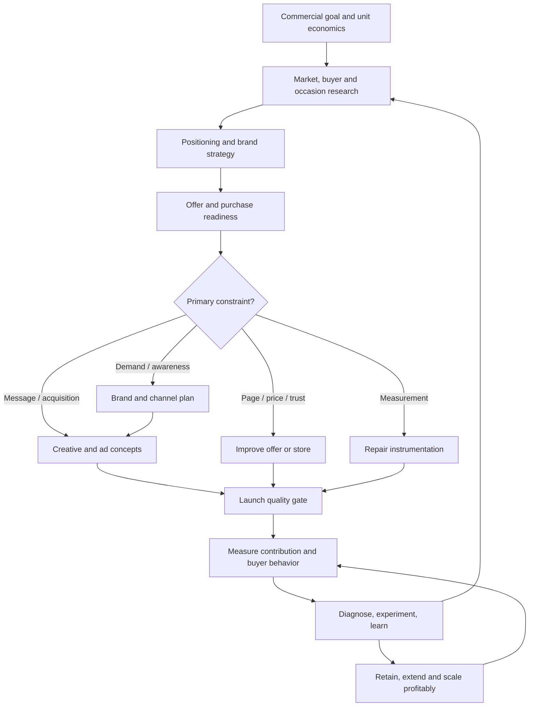

# Marketing operating system — question → evidence → decision → action → learning

This is the **operational layer** of [Marketing OS](SKILL.md). It is a repeatable, evidence-grounded approach to choosing what marketing work to do, making it, and learning whether it worked. **Never jump directly from product title to ad copy unless the user only requests a quick rewrite.** The full system is modular, not a compulsory nine-stage report. For discovery-to-purchase work use [SEO 5A](workflows/05a-seo-and-organic-search.md), [AEO 5B](workflows/05b-aeo-ai-search-visibility.md) and [CRO 4A](workflows/04a-conversion-rate-optimization.md) as **optional specialist sub-workflows**, not new compulsory stages. For one offering that needs holistic investigation and a product-level marketing plan, use [Workflow 1A: offering discovery → marketing plan](workflows/01a-offering-discovery-and-marketing-plan.md); it joins product truth, buying situations, alternatives, pricing, risks, proof and communication into one decision dossier. For an unknown brand, insert [Workflow 3A: brand discovery → voice → messaging library](workflows/03a-brand-discovery-and-messaging.md) before positioning or creative; it is an optional sub-workflow, not an additional mandatory stage.

## The operating loop

**Never treat a conceptual framework as proof.** Label observations `verified`, `buyer-reported`, `inferred`, `hypothesis`, or `unknown`. Keep product/claim truth separate from confidence in buyer motivation and causal effect. Use credible primary documents, customer research, commerce data and experiments; make clear what is missing. A competing explanation is mandatory for a strategic recommendation.

## Nine workflows and handoffs

| Stage | Essential questions | Minimum evidence | Decision / artifact | Move forward when… |
|---|---|---|---|---|
| [1. Diagnose business and product](workflows/01-commercial-diagnosis.md) | What product, objective, profit constraint, inventory, time horizon? | Catalog, price, costs, sales, inventory, returns | Commercial scorecard and chosen product/job | Product, objective, allowable economics, and known unknowns are clear |
| [1A. Research a particular offering and create a marketing plan](workflows/01a-offering-discovery-and-marketing-plan.md) *(optional within Stage 1; orchestrates 2–8)* | What is actually sold, who values it and why, why might they not buy, how can it be positioned, offered, communicated and tested? | Actual product/service specs and terms, brand evidence, buyer data, alternatives, economics, claims/rights | [Offering dossier + copy bank + marketing plan](templates/offering-dossier-and-marketing-plan.md) | Core promise, buyer choice, evidence/unknowns, blockers and next actions are explicit |
| [2. Research buyers and occasions](workflows/02-buyer-discovery.md) | Who buys, when, why, instead of what, with which doubts? | Reviews, support, interviews, search, analytics | Buyer/job/occasion map and objection register | At least one plausible buying situation and evidence/confidence are documented |
| [3. Position and build brand](workflows/03-positioning-and-brand.md) | Why this vs alternatives; what should people recognize? | Competitor offers, product proof, assets, buyer data | Positioning statement, reasons to believe, brand cue map | Claims are supportable and the fit is coherent |
| [3A. Discover the brand and distill copy](workflows/03a-brand-discovery-and-messaging.md) *(optional within stage 3)* | What are its demonstrated identity, perspective, voice, selling points, personality and competitive advantages? | Site, owned copy, product evidence, customer language, reviews, competitors, owner goals | Voice guide, brand truth and approved [messaging library](templates/brand-messaging-library.md) | Claims, voice confidence and approval status are clear |
| [4. Build the offer and store](workflows/04-offer-and-conversion.md) | Does the page/price/fulfillment resolve purchase risk? | PDP, cart, payment, shipping, return policies | Offer/PDP readiness review, prioritized blockers | No critical trust/claim, stock, margin, or checkout issue is ignored |
| [4A. Diagnose and optimize conversion](workflows/04a-conversion-rate-optimization.md) *(optional within Stage 4 and Stage 8)* | Are qualified visitors blocked by friction, confusion, policy, price, UX or tracking? | Analytics/CRM, actual task observation, checkout/page evidence | Fix list, [experiment brief](templates/cro-experiment-brief.md), outcome guardrails | Known defects fixed; remaining hypotheses tested appropriately |
| [5. Plan channels and campaigns](workflows/05-channel-and-campaign.md) | Create memory, capture demand, convert, or retain? | Objectives, capacity, budget, customer journey | Channel roles, campaign hypothesis and measurement plan | Each channel has a job and success metric |
| [5A. Plan organic search/SEO](workflows/05a-seo-and-organic-search.md) *(optional within Stage 5)* | Which buyer intents should pages serve, and are those pages eligible/useful? | GSC, crawl, query data, site structure, product truth | Intent-to-page map, technical fixes, content briefs, [search audit](templates/search-and-conversion-audit.md) | Critical eligibility issues and page claims addressed |
| [5B. AI answer discovery/AEO](workflows/05b-aeo-ai-search-visibility.md) *(optional extension of 5A)* | Can trusted, useful sources answer buyer questions and be discoverable/cited? | Crawl/index evidence, first-party sources, platform reports | Question-answer plan and qualified citation monitoring | No unsupported claims or guaranteed AI inclusion |
| [6. Produce ads and creative](workflows/06-creative-production.md) | Which buyer insight becomes which distinct angle, visual, message? | Verified claim ledger, positioning, real creative | Creative matrix, primary text/headline/description, landing page link | Ads are distinct, grounded, coherent, brand-linked and policy-reviewed |
| [7. Launch safely](workflows/07-launch-qa.md) | Is everything valid, tracked, previewed, and authorized? | Draft ad units, account setup, test purchase, approvals | Launch checklist and configuration log | All critical checks pass and publishing is explicitly authorized |
| [8. Measure and decide](workflows/08-measure-diagnose-experiment.md) | Where is the constraint? Did the intervention cause improvement? | Store orders, platform data, channel mix, feedback | Diagnosis, experiment, keep/change/stop recommendation | Evidence is sufficient for the decision; if not, state uncertainty |
| [9. Retain and grow](workflows/09-retention-and-scale.md) | Are repeat purchases and reach economically sound? | Cohorts, returns, CRM permissions, unit economics | Lifecycle, merchandising and expansion plan | Incremental profit and customer experience support the action |

## Choose a workflow from the actual situation

| Situation | Start here | Why |
|---|---|---|
| Investigate one product/service and create a marketing plan or full copy bank | Brand scan/3A if needed → 1A → relevant stages 2–8 | Produce a single offering dossier connecting facts, buyers, value, objections, price, copy and the prioritized plan |
| New product with no sales | 1 → 2 → 3 → 4 | Validate demand and economics before buying reach |
| New or unfamiliar brand; scattered, inconsistent copy | 2 → 3A → 3 → 6 | Discover brand reality, customer perception, voice and approved language before creating ads |
| Need SEO audit or organic search launch | 1A → 2 → 5A → 4A where relevant | Search intent, indexability, helpful product content and the qualified search-to-sale journey |
| Need AEO/GEO/AI answer citations | 5A → 5B (and 1A/3A for facts) | Search eligibility and original answer resources before AI visibility measurement |
| Lots of traffic but checkout/forms underperform | 8 → 4A → 4 or 1A | Verify data, diagnose friction and customer fit, fix defects before tests |
| New Meta campaign for an existing profitable SKU | 2 → 3 → 5 → 6 → 7 | Product economics may be known; still ground message |
| Ad has clicks but no purchases | 8 → 4 → 2 or 6 | Could be traffic quality, mismatch, trust, price, checkout or tracking |
| Many purchases, low profit | 1 → 4 → 8 | Fix contribution, returns, offer and acquisition cost |
| Competitors own category memory | 2 → 3 → 5 | Need occasions and distinct assets, not just discounts |
| Campaign performing but plateauing | 8 → 2 → 6 or 9 | Test additional buying occasions, reach and products |
| Existing customer base not repurchasing | 9 → 2 | Understand whether repeat purchase is natural for category |
| 'Write three ads quickly' | 6 (lightweight) | Respect scoped writing requests; never invent claims |

## Decision rules

1. **Fix real blockers before buying attention.** Checkout failure, out-of-stock, deceptive copy, unsupported claims or obvious margin losses trump a copywriting task.
2. **Separate organic visibility from buyer success.** SEO and AI citations increase opportunities to be discovered but do not guarantee qualified traffic or orders; CRO fixes the actual consideration/purchase path. Review search platform rules and do not manufacture answer-engine citations.
3. **Keep business and brand objectives distinct.** Last-click ROAS is not a complete measure of future demand; brand work still needs a credible evaluation plan.
3. **Marketing solutions are multi-modal.** A customer objection can require copy, photo, comparison, demonstration, policy, pricing, product improvement—or no targeting of that customer.
4. **Match the proof to the promise.** Each message/visual/landing page must support what it claims; no fictional social proof, urgency, guarantees or material properties.
5. **Experiment with decisions, not synonyms.** A useful test isolates one strategic question where possible. Do not report platform attribution as causal incrementality.
6. **The creative is a product communication system.** Map buyer motive and claim evidence into a visual event, brand cue, readable overlay/speech, placement adaptation and landing-page handoff. Check rights, creator disclosures, automatic modifications and smartphone preview; see [creative production](workflows/06-creative-production.md).
7. **Avoid sensitive-attribute assumptions and manipulative tactics.** Use occasion/product-based framing and current platform standards.
8. **No autonomous spend or publishing.** Planning, research and drafts are permitted; modifications to campaigns, budgets, promotions and customer messages require clear user authorization.

## Core artifacts and their consumers

| Artifact | Producer | Consumer |
|---|---|---|
| [Commercial + product brief](templates/operating-brief.md) | Workflow 1 | All subsequent stages |
| Buyer/occasion map + evidence ledger | Workflow 2 | Positioning, ad production, PDP, lifecycle |
| Positioning / reason-to-believe / brand cues | Workflow 3 | Offer, creative, channels |
| [Offering intelligence dossier](templates/offering-dossier-and-marketing-plan.md) + [adaptive product/service intake](templates/offering-discovery-intake.md) | Workflow 1A | Buyer research, offer/PDP, positioning, channels, creative and experiment design |
| [Brand voice and copy library](templates/brand-messaging-library.md) + [discovery intake](templates/brand-discovery-intake.md) | Workflow 3A | Positioning, creative, web copy, lifecycle, product catalog |
| Product page and offer checklist | Workflow 4 | Ad claims and landing page QA |
| Campaign hypothesis and measurement plan | Workflow 5 | Creative, launch, experiment |
| [SEO/AEO/CRO audit and intent-to-page map](templates/search-and-conversion-audit.md) | Workflows 5A/5B/4A | Search pages, answer resources, PDP/landing improvements and measurement |
| [CRO experiment brief](templates/cro-experiment-brief.md) | Workflow 4A | Research, engineering, QA and Stage 8 decisions |
| [Creative concept brief](templates/creative-production-brief.md) + [direction/storyboard](templates/creative-direction-brief.md) | Workflow 6 | Production team, placement adaptations, launch QA |
| Launch checklist | Workflow 7 | Campaign owner |
| [Test and decision log](templates/experiment-decision-log.md) | Workflow 8 | Future buyer research, channel allocation, scaling |
| Retention and assortment plan | Workflow 9 | Merchandising and lifecycle communications |

## Rhythm: who does what, when

- **Per new product/category:** review economics, customer decision, parity/difference, claim evidence and purchase path before promoting.
- **Per new campaign:** choose one commercial goal, choose the buyer occasion, propose distinct creative hypotheses, name the primary metric, verify the destination, approve launch.
- **At regular reporting intervals:** reconcile ad reports with store sales and costs, check data quality, annotate promotions/seasonality, diagnose the biggest constraint, prioritize a small number of changes.
- **After meaningful tests:** log hypothesis, design, observations, interpretation, confounders, conclusion and what to do next. Retain learning even if inconclusive.
- **Periodically:** reconsider brand entry points, repeat-purchase opportunities, customer satisfaction, returns and contribution margin before scaling.

## Source-backed guardrails

- Meta Blueprint [creative development](https://www.facebookblueprint.com/student/path/211553-ads-manager-visual-ads-course), [Ads Manager workflow](https://www.facebookblueprint.com/student/collection/507792-meta-ads-manager-learning), and [testing/lift](https://formedia.facebookblueprint.com/student/path/219763-ab-test-conversion-brand-lift-course).
- [Baymard product-page UX research](https://baymard.com/research-articles/current-state-ecommerce-product-page-ux) and [Shopify's product-page checklist](https://www.shopify.com/blog/expert-advice-improve-product-pages) reinforce that landing-page purchase readiness matters.
- [Ehrenberg-Bass category entry points](https://ebims.emdev.au/research-services/identifying-and-prioritising-category-entry-points/) explains the role of memory and buying occasions.
- [Google's lift explanation](https://support.google.com/google-ads/answer/14102450?hl=en) clarifies the difference between attributed and incremental conversions. This is a general measurement principle; use Meta's actual tools for Meta campaigns.

See also the theory layer: [marketing fundamentals](references/marketing-fundamentals.md), [buyer research](references/buyer-research.md), [brand strategy](references/brand-strategy.md), [value/pricing](references/product-value-and-pricing.md) and [marketing effectiveness](references/marketing-effectiveness.md).
